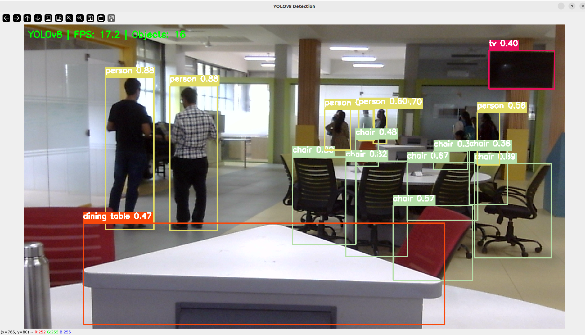
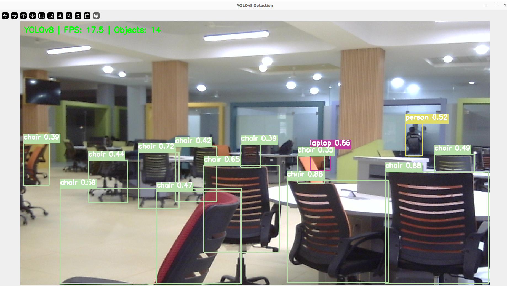
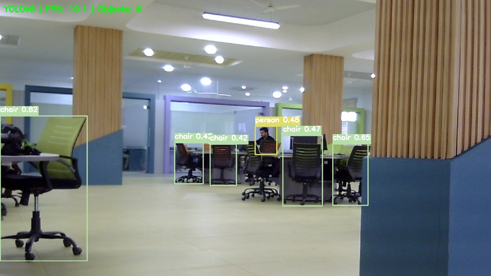
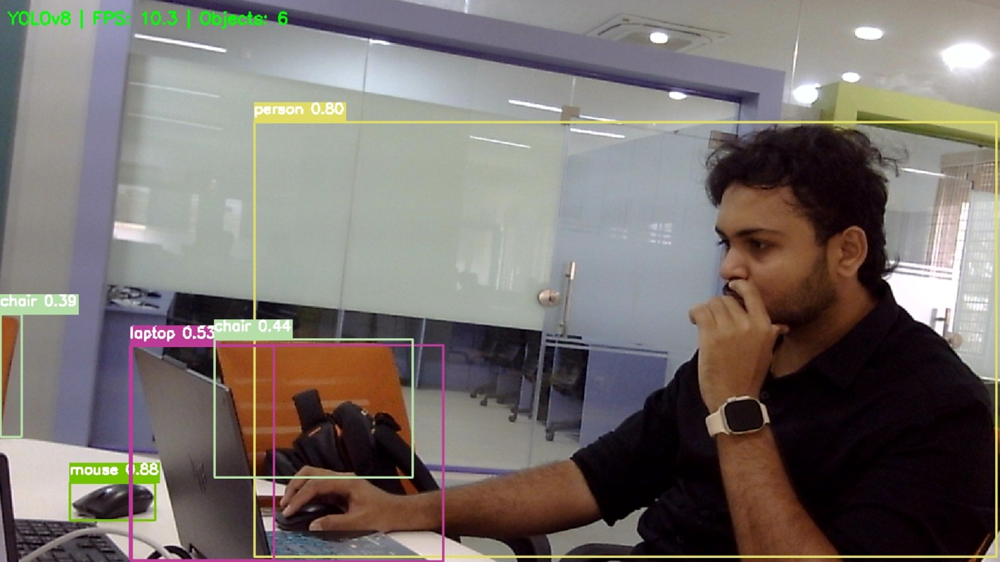
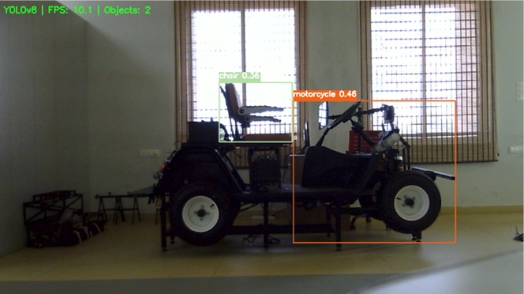

# Real Time Object Detection Using ROS 2 and YOLO

A real-time object detection project built with **ROS 2 Humble**, Python, OpenCV, and YOLO ONNX models. The project captures webcam frames, publishes images through ROS 2, and detects objects using a YOLO-based detection node.

**GitHub Repository:** https://github.com/chidambardesai/Real-time-object-detection

## Features

- Real-time object detection using a webcam.
- ROS 2 image publishing and processing.
- YOLO object detection using ONNX models.
- Multiple model options: YOLOv5n, YOLOv5s, YOLOv5m, and YOLOv8.
- Visual output screenshots from detection experiments.

## Project Structure

```text
Real-time-object-detection/
├── Images/
│   ├── 1.png
│   ├── 2.png
│   ├── Picture9.jpg
│   ├── Real_time1.jpg
│   └── Real_time2.png
├── object_detection/
│   ├── __init__.py
│   ├── webcam_publisher.py
│   ├── yolo_detector.py
│   ├── yolov5n.onnx
│   ├── yolov5s.onnx
│   ├── yolov5m.onnx
│   ├── yolov5m.onnx.1
│   └── yolov8.onnx
├── resource/
├── test/
├── package.xml
├── setup.cfg
├── setup.py
├── .gitignore
└── README.md
```

## Requirements

- Ubuntu Linux
- ROS 2 Humble
- Python 3
- `colcon`
- `rosdep`
- Webcam
- Python dependencies required by the detection implementation, including OpenCV and ONNX Runtime as applicable

## Installation

### 1. Clone the repository

```bash
cd ~/ros2_ws/src
git clone https://github.com/chidambardesai/Real-time-object-detection.git
```

### 2. Install dependencies

Ensure ROS 2 Humble is installed and sourced:

```bash
source /opt/ros/humble/setup.bash
```

Install the dependencies declared in the package:

```bash
cd ~/ros2_ws
rosdep install --from-paths src --ignore-src -r -y
```

Install any additional Python dependencies required by the source code.

### 3. Build the package

```bash
cd ~/ros2_ws
colcon build --packages-select object_detection
```

Source the workspace:

```bash
source /opt/ros/humble/setup.bash
source ~/ros2_ws/install/setup.bash
```

## How to Run

Use separate terminals for the webcam publisher and YOLO detector.

### Terminal 1: Start the webcam publisher

```bash
source /opt/ros/humble/setup.bash
source ~/ros2_ws/install/setup.bash
ros2 run object_detection webcam_publisher
```

This starts the webcam publisher node.

### Terminal 2: Start the YOLO detector

```bash
source /opt/ros/humble/setup.bash
source ~/ros2_ws/install/setup.bash
ros2 run object_detection yolo_detector
```

This starts the object detection node.

Ensure that the webcam is accessible and that the publisher and detector use compatible ROS 2 topics.

## YOLO Models

The repository includes these ONNX model files:

| Model | Description |
|---|---|
| `yolov5n.onnx` | YOLOv5 Nano |
| `yolov5s.onnx` | YOLOv5 Small |
| `yolov5m.onnx` | YOLOv5 Medium |
| `yolov8.onnx` | YOLOv8 model |

The configured model path and supported input/output formats depend on the implementation in `yolo_detector.py`. The presence of a model file does not guarantee that the node supports switching models without configuration changes.

## Output Screenshots

The following images show outputs from the project.

### Detection Result 1



### Detection Result 2



### Additional Result



### Real-Time Detection





## Troubleshooting

**Package not found**

```bash
source /opt/ros/humble/setup.bash
source ~/ros2_ws/install/setup.bash
```

**Webcam not detected**

Check whether the camera is connected and accessible to the user.

**Model file not found**

Verify the model path configured in `yolo_detector.py`.

**Missing Python dependencies**

Install the required packages and rebuild the workspace if necessary.

**No detection output**

Verify that both nodes are running and that the image topic and model configuration match.

## Author

**Chidambar Desai**

GitHub: [@chidambardesai](https://github.com/chidambardesai)

## License

Copyright © 2026 Chidambar Desai. All rights reserved.

This repository is publicly available for viewing. No license has been granted for copying, modifying, distributing, or using this project's code without the author's permission.
